# Project CHAMELEON: team onboarding

Status: 23 October 2026. Start here if you have not worked on the project. This guide records existing results; no new benchmark, training or Docker run was performed to write it.

## 1. The challenge

Given a design JSON and a target canvas, return the same elements arranged for the new format, plus a rendered preview. A poster might become a story, presentation or narrow banner. The task is to rearrange the furniture, not stretch a screenshot.

Keep element IDs and counts, text content, font family, assets and styling unchanged. The intended edits are `x`, `y`, `width`, `height` and `font_size`. Everything must remain visible and on the canvas; ordinary images keep their proportions within about 5%. No regenerated pixels or replacement assets. There is no editable crop/focal-point field: existing `fit: cover` backgrounds may use the renderer’s centred crop; other images must preserve their aspect. The README also documents scaled letter spacing and mirrored rotation as legacy assumptions—confirm those interpretations before submission.

Run offline in a CPU-only Docker container with `--network none`. Deterministic means the same input produces exactly the same output. **Stage 1 has no hard execution-time limit**, per the challenge PDF (owner-confirmed) and `RULES.md:11`; speed and reliability remain a rubric row. A slow engine may still time out on the **Apple M5 Pro reference machine** (`RULES.md:32`), whose exact CPU/RAM/disk limits remain unconfirmed. Our **13.5 CPU seconds per case** is an engineering target, not an official cutoff; **331 MB** is a historical image-size measurement.

Both structural JSON checks and an **AI visual judge** matter: a valid JSON can still look bad. Any learned weights must be publicly accessible, for example on Hugging Face, and available before offline execution. ONNX is our portable CPU model-file format. The working deadline is **around November 2, unconfirmed**. Stage 1 deliverables in the challenge PDF, as confirmed by the project owner, are **engine code + Dockerfile + a short read-me**; the **Express add-on is for the finale only**. **Unresolved conflict:** local `FAQ.md:105` instead includes a required, unscored viewer add-on in Stage 1. Confirm this discrepancy with the organisers before code freeze. The PDF is not on this Mac; that distinction comes from the owner’s reading, not a new PDF inspection.

## 2. How the engine works

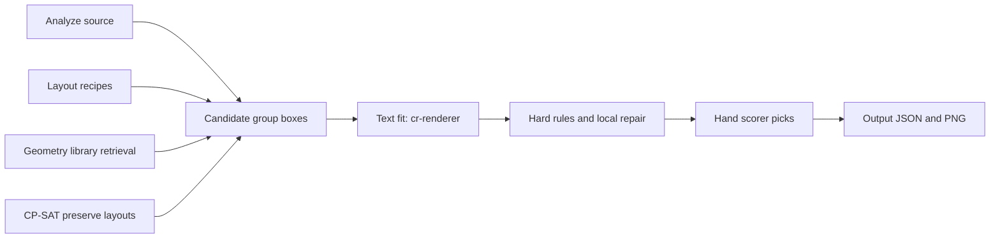

**Analyze.** `engine/analyze.py` identifies backgrounds, text roles, reading order and elements that belong together. A rigid unit is a group moved and scaled as one piece; repeated rows and grids can also be recognised. Getting this structure wrong can spoil every later candidate.

**Candidates.** Recipes propose familiar structures such as a column, image/text split or banner strip. Retrieval borrows boxes from a library of **1,494 layouts**, roughly **0.5 MB**, containing geometry and roles rather than text or pixels. CP-SAT is a small constraint solver: its preserve layouts move the original design as little as possible while respecting geometric rules. Four variants trade off keeping size, position and edge anchoring.

**Text fit.** `engine/fit.py` measures wrapping with **cr-renderer**, the supplied renderer. It chooses font sizes that fit, scales rigid units uniformly and places attachments and decorations. The renderer sees the real text transiently; learned generator data stores geometry and character counts rather than text strings.

**Checks and selection.** Hard rules reject invalid layouts; local repair fixes what it can without redesigning the page. The hand scorer is a weighted collection of geometric and legibility penalties. It ranks candidates, checks rendered contrast on a small shortlist and picks an output. It is a useful proxy, not a human judge. The integration branch now guarantees candidate-path coverage before spending a shared extra budget.

## 3. Which baseline do we ship?

**v5 is the current mainline/measurement baseline; v4 is the frozen submission fallback.** They are different roles, not interchangeable names.

| Role | Ref | Commit |
|---|---|---|
| Frozen, previously Docker-tested fallback | `submission-fallback`, also `v4` | `14ea0dc89298aa2c11912e22f4c5d8265297b2b3` |
| Working mainline baseline | `main`, also `v5` | `3b607e48501b3021ad347d21693225eb70f23396` |
| Rules experiment | `rules` | `6e80cdd` |

`HANDOFF.md` explicitly says to ship `submission-fallback` if experiments go nowhere. `NOTES.md` §29 records v5 merged to main. The committed rules-versus-v5 dev comparison uses v5, not v4: mean hand score **91.493 → 89.414**, with **46 drops greater than 10 points**. These are hand-score comparisons, not proof of visual quality. Nothing here promotes an experimental branch over the frozen fallback.

To run the frozen fallback, use a separate checkout; do not switch a shared worktree:

```sh
git worktree add --detach ../chameleon-fallback submission-fallback
cd ../chameleon-fallback
docker build --platform linux/amd64 -t chameleon:fallback .
mkdir -p output
docker run --rm --network none \
  -v "$PWD/input:/app/input:ro" \
  -v "$PWD/output:/app/output" \
  chameleon:fallback
```

Build-time dependency downloads are separate from offline runtime. Each input task produces an output JSON and PNG. The frozen fallback’s recorded no-cache test passed all **45 organiser cases**, slowest **12.95 s**. The later v5 Docker run recorded median **6.3 s**, slowest **12.9 s**. Neither was rerun for this guide.

The baseline handles ordinary text/image compositions and moderate shape changes reasonably well. Collages, icon rows, CVs/invoices squeezed into banners and many-small-element designs remain weak.

### Ten labelled examples: v5 working baseline

Every image reuses an existing source and v5 output: **source left, output right**. These are the author’s labels on the v5 review snapshot (`6a0f590`, “v5”), not labels transferred to v4 or to today’s integration outputs. There are four good, three okay and three bad designs; one output per design. The gallery is from `crello-review-v5-random`; the bad captions retain its recorded diagnostic tags.

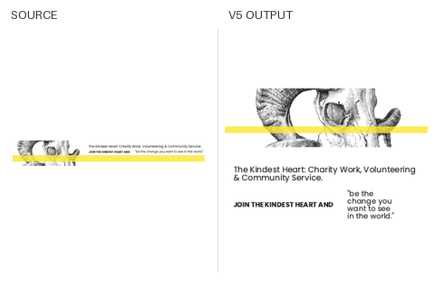

1. Medium rectangle (300×250) — **good**.

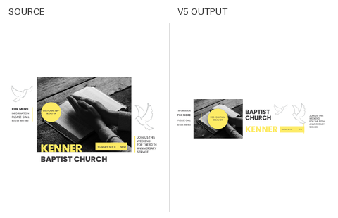

2. LinkedIn banner (1584×396) — **good**.

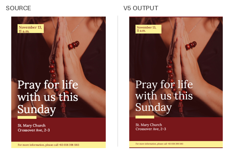

3. A4 poster (150 dpi) (1240×1754) — **good**.

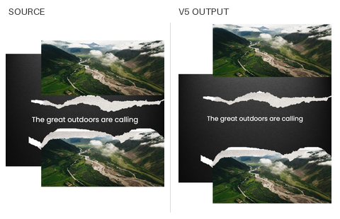

4. Instagram portrait (1080×1350) — **good**.

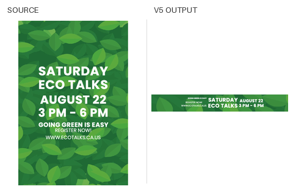

5. Leaderboard (728×90) — **okay**.

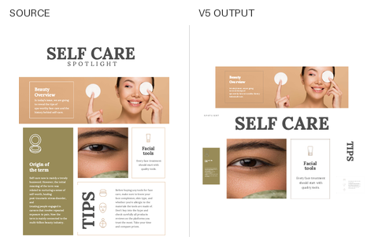

6. Medium rectangle (300×250) — **okay**.

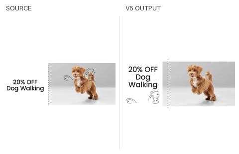

7. Presentation (16:9) (1920×1080) — **okay**.

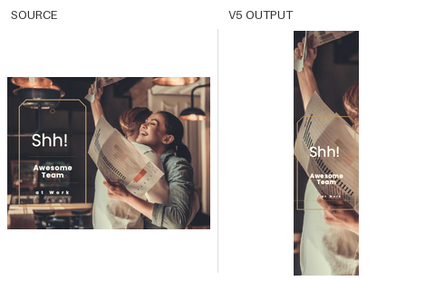

8. Wide skyscraper (160×600) — **bad**; failure tag: crop or aspect problem.

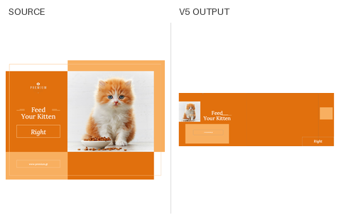

9. Email header (600×200) — **bad**; failure tag: other.

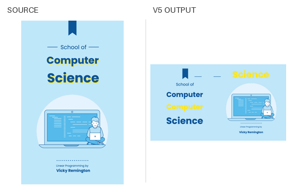

10. X post (1600×900) — **bad**; failure tag: scattered grouping.

## 4. How we measure quality

The reported human-evaluation snapshot has **245 labels: 41 good / 33 okay / 171 bad**. Its hand scorer gets pooled pairwise **0.830** (how often it orders differently labelled outputs correctly), bad-versus-rest AUC **0.841** (how well scores separate bad from other outputs), in-band AUC **0.754** for hand scores at least 85, and within-design **0.546** averaged across 15 designs. The separate pair-weighted within-design result is 0.788; it is dominated by organiser-sample pairs and should not replace 0.546.

**Counting labels correctly:** the eight local files contain **227 top-level cases and 245 labelled outputs**, including saved histories: **41 good / 33 okay / 171 bad**. The organiser file contains 45 cases plus 18 historical outputs, making the reported 63 labels. `critic/eval.py` and `eval/calibrate.py` deduplicate by case and exact output, keeping the latest verdict. No matching-snapshot labels are missing.

**Recall** here means the share of 40 test cases whose displayed candidate pool contains at least one human-acceptable layout. It does not mean the engine picked that layout. The rules page had **17/39 reviewed** acceptable; the generator page had **15/40**. One rules case was unreviewed, so keep denominators visible. Human labels and labelled designs are evaluation-only: never training or early-stopping data.

## 5. What we tried, in order

1. **Learned critic (`critic`).** A critic scores a proposed output; it does not generate the layout. The **1.84M-parameter transformer**—a neural model of relationships between groups—trained on synthetic damage pairs reached **0.883** on its own validation set but only **0.578** on human labels, versus the hand scorer’s **0.830**. A simple shortcut model did even better on synthetic validation. Parked: it learned shortcuts rather than useful visual judgement.

2. **Failure diagnosis (`diagnose`).** Historical overlapping tags: **scatter 25, white space 22, reading order 13**. Collages, banners and many small elements were especially hard. The local tag server makes failures and candidate pools reviewable instead of relying only on aggregate scores.

3. **Rules (`rules`).** Group-aware generation and new scorer terms improved observed candidate recall from about **38% to 44% (17/39)**. The rules-versus-v5 score drop above is a reminder that our hand score and human preferences can disagree. These changes are not merged into main.

4. **Learned layout generator (`generator`, `gen-integration`).** Experiments used **18,108 Crello designs after campaign deduplication**—removing related templates to avoid leaking a design across splits. A CVAE transformer reads groups and uses a small hidden code to propose varied box layouts. Its **6 MB ONNX** model beat offline box-distance baselines, but human candidate recall was **15/40**, with no gain. Diagnostics found **0 cases where only the generator supplied an acceptable layout**. Three previously acceptable layouts disappeared because of the new count caps. Inspected raw samples piled content near the middle without a convincing sense of format; fitting also changed geometry and independently fitted text sizes.

5. **Side benefits retained.** Fixed count budgets replace machine-speed-dependent cutoffs; repeated outputs have **0 byte mismatches**, also under doubled load. An earlier generator-on integration maximum was about **7.2 s CPU** on 600 dev cases. The latest, different default-off path-minimum policy is below; do not treat those two timings as the same configuration.

## 6. Where we are now

The generator is **OFF by default**; `GEN_ON=1` opts in (`GEN_OFF=1` still forces it off). The default path imports neither `onnxruntime` nor the generator and reads no model. Its opt-in smoke still fitted eight passing proposals.

The per-path cap fix is **complete**, not pending: recipe families, feasible preserve variants, retrieval rank strata and applicable realization modes get guaranteed representation before shared extras. All three lost accepted layouts returned **pixel-exact and passing hard rules**. This is pool recovery: two are in the displayed top eight, and only the LinkedIn layout is the final pick. The portrait preserve layout remains below the display cutoff. There is no newly labelled recall figure for the changed pool.

| Latest integration result: 600 dev cases, generator off | Value |
|---|---|
| CPU p50 / p95 / max | **1.29 / 3.49 / 6.82 s** |
| Mean hand-score change vs rules | **−0.614** |
| Regressions greater than 10 points vs rules | **17** |
| Determinism mismatches, normal / doubled load | **0 / 0** |

These are native Mac measurements, not a fresh Docker or slower-machine guarantee. The scorer, its weights and the preserve solver are unchanged.

Analysis is a current hypothesis: a large photo may not be recognised as a backdrop, or card contents may be split into separate units. **18/25 failed recall cases** have at least one audit flag, but the comparison is now available:

| Audit measure | Failed cases | Acceptable cases |
|---|---|---|
| Cases with backdrop flags | **24%** | **26.7%** |
| Split contained elements per case | **4.92** | **1.20** |
| Splits without panel/host links per case | **3.00** | **0.60** |

Backdrop flags do not distinguish these groups. The split counts are correlated with failure, **not proven causes**: failed designs may simply be more complex. Normalise by element count next. Some separate units have explicit panel/host links, so “split” does not automatically mean “unrelated.”

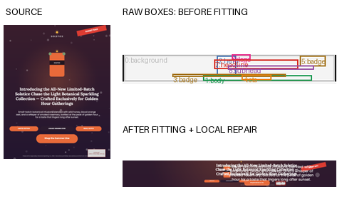

Organiser leaderboard example, reused from the diagnostic viewer. Left: source. Upper right: one raw generator wireframe before fitting; overlapping coloured boxes show group roles. Lower right: that same sample after text fitting and local repair. This is an illustration, not another Crello gallery design or a new human label.

Scorer evidence is also mixed. LinkedIn’s acceptable layout already scored **92.67 versus 90.46** for the bad generator layout; caps had excluded the better option. In the portrait case, the bad layout scored **90.03 versus 80.88**, mainly through **coverage and key-size** terms. Only those two cases have confirmed acceptable comparators; ten others remain unknown. No scorer changes have been made.

Next: test analysis changes for backdrops and card/container membership, normalise the audit by complexity, and measure whether candidate quality improves. A container-based version-2 generator is a possible later experiment, not an approved replacement. The cap fix does not need repeating.

## 7. Project map

| Branch | Purpose | Merge state |
|---|---|---|
| `main` | v5 mainline engine | Includes the v5 work; does not include rules/critic/generator experiments |
| `critic` | Learned ranking model and optional search | Not merged to main; ancestor of rules/integration |
| `diagnose` | Human-label metrics and diagnostic pages | Not merged to main; included in rules/integration history |
| `rules` | Group-aware candidate generation and scorer rules | Not merged to main; integration is based on it |
| `generator` | Generator data, training and ONNX export | Not merged to main or integration as a branch |
| `gen-integration` | Generator adapter, default-off switch, deterministic path budgets | Based on rules; generator package was copied in, not merged |
| `team-docs` | This guide, based on main | Documentation only; not merged |

Experimental branches remain separate from main. Fetch `origin` and inspect `git branch -r` before choosing one; a published experimental branch is not a merge into main or an approved submission.

On the shared Mac, `/Volumes/Extreme/AdobeHackathon/` contains:

- `chameleon`: shared primary checkout, currently on `rules`; its existing `.venv` is the shared Python environment. Do not switch it under another worker.
- `chameleon-gen`: generator training worktree (`generator`).
- `chameleon-int`: integration worktree (`gen-integration`).
- `chameleon-docs`: this isolated documentation worktree (`team-docs`).
- `data/crello_chameleon`: raw Crello Parquet and existing local evaluation designs/assets.
- `data/critic`: critic examples, checkpoints and evaluation caches.
- `data/generator`: sanitised generator data, pairs, runs and checkpoints; `integration/diagnostic/` holds the viewer/audit; `integration/path_budget/` holds final cap and scorer evidence.

Labels are local `eval/results/**/labels.json` files and `failure_tags.json`, `recall_tags.json`, `recall2_tags.json`, `recall3_tags.json`, in the checkout that owns each review page. Do not overwrite or copy them into training. Raw Crello designs/assets, weights and generated evaluation pages stay out of code commits. This guide’s small, requested gallery is documentation, not shipped inference data.

Claude Code and Codex have both been used. Use your own worktree, read its instructions first (`CLAUDE.md` / `AGENTS.md` where present), and coordinate branch ownership. The root `HANDOFF.md` is absent from main; the critic handoff is available in the critic/generator work. Main’s README and older handoff sections are historical, not the latest integration status.

## 8. Getting started

Use Python 3.11. In your **own** checkout, create a private environment if needed; do not upgrade the shared environment:

```sh
python3.11 -m venv .venv
source .venv/bin/activate
python -m pip install -r requirements.txt -r requirements-dev.txt
```

On the shared Mac, the existing interpreter is `/Volumes/Extreme/AdobeHackathon/chameleon/.venv/bin/python`. Crello evaluation needs the local dataset path, usually `CRELLO_CHAMELEON=/Volumes/Extreme/AdobeHackathon/data/crello_chameleon`. Set `TMPDIR=/Volumes/Extreme/AdobeHackathon/tmp` there. New clones do not contain the dataset, review images or model weights.

Run one provided task through the Python API:

```sh
.venv/bin/python - <<'PYONE'
import json
from pathlib import Path
from engine.resize import resize
job = json.loads(Path("input/chameleon_sample_level1_warmup.json").read_text())
output = resize(job["source"], job["target_canvas"])
Path("/tmp/chameleon-one-output.json").write_text(json.dumps(output, indent=2))
PYONE
```

`python -m engine.main` processes all tasks in `input/` and writes JSON/PNG outputs. For evaluation, commands documented in the README include:

```sh
.venv/bin/python -m eval.bench --suite quick --jobs 4
.venv/bin/python -m eval.bench --suite crello-dev --render --jobs 4
.venv/bin/python -m eval.snapshots compare v5 --suite crello-quick
```

Run those only in your own worktree: benchmarks can overwrite result CSVs and summaries. They consume CPU; coordinate full runs and Docker tests. None were run to build this guide.

Label tooling is on `rules`/integration, **not main**. On the shared Mac:

```sh
cd /Volumes/Extreme/AdobeHackathon/chameleon-int
export TMPDIR=/Volumes/Extreme/AdobeHackathon/tmp
/Volumes/Extreme/AdobeHackathon/chameleon/.venv/bin/python -m eval.tag_server --port 8781
```

Then open `http://127.0.0.1:8781/recall3/`. Labels save in that checkout. The existing recall3 page is the frozen generator-on comparison, not the new default-off pool. Coordinate before relabelling it.

## 9. Tasks a teammate can pick up

| Task | First useful result |
|---|---|
| Analysis: backdrops and cards | Normalise the audit by element count, inspect real containers, then test detection/grouping changes without blindly merging every containment. |
| Collage and icon-row grid recipe | Keep repeated cards/icons together while adapting the number of rows/columns. |
| Scorer: sibling consistency and box-to-content | Diagnose whether equal-status siblings and space inside proposed boxes explain confirmed human disagreements; keep the scorer frozen until evidence is clear. |
| Auto-recall filter | Prioritise candidate pools likely to lack an acceptable option; validate against human recall rather than hand-score gains. |
| Docker with limited CPUs | Check offline correctness, determinism, image size and worst-case time on a constrained machine. |
| README/HANDOFF refresh | Reconcile mainline, frozen fallback, experimental branches, label-history counting and the new default-off integration. |
| Licence email to organisers | Confirm treatment of Crello-derived geometry and learned weights, and document the reply. |
| Official deadline | Confirm the approximate November 2 date and final submission checklist. |

Evidence used: the listed README/RULES/NOTES/CLAUDE files; critic HANDOFF in `chameleon-gen`; local tags/branch history and committed rules-vs-v5 CSVs; `chameleon-int/generator/INTEGRATION.md`; the diagnostic and analysis-audit reports; and existing review labels/renders. Latest integration figures above are the owner’s newer status update. No benchmark, training, Docker run or fresh engine rendering was needed.
